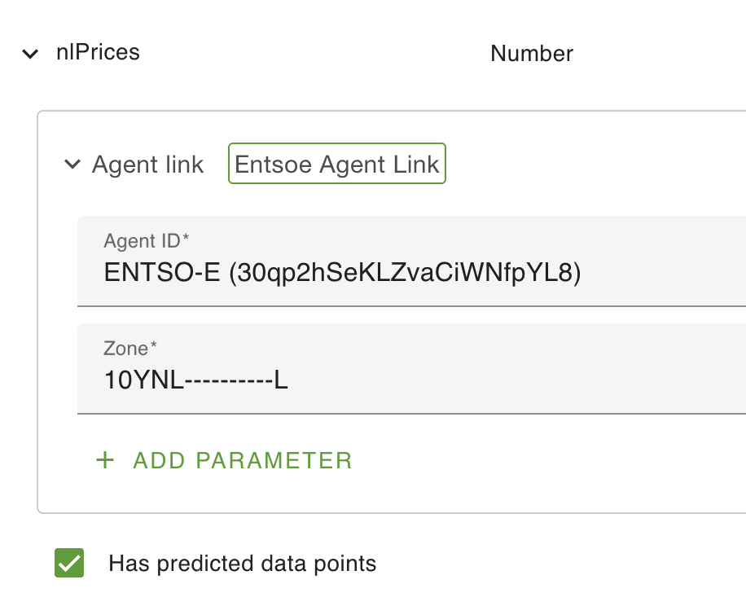

# ENTSO-E

## Introduction

[ENTSO-E](https://www.entsoe.eu/data/transparency-platform/) is a European transparency platform for the energy market that provides
a large collection of energy related data.

This agent uses their [REST API](https://documenter.getpostman.com/view/7009892/2s93JtP3F6#3b383df0-ada2-49fe-9a50-98b1bb201c6b) to retrieve the `Energy Prices` (document type A44) data.

## Prerequisites

Accessing the REST API requires a security token. You must create an account and request such a token for your own usage.  
To do so, follow the process described at [How to get security token? – Transparency Platform](https://transparencyplatform.zendesk.com/hc/en-us/articles/12845911031188-How-to-get-security-token).

## Agent usage

### ENTSO-E Agent

To get access to the data, add an ENTSO-E agent to your configuration.  
On the agent, fill-in the `Security token` attribute with the token you got from ENTSO-E (see [Prerequisites](#prerequisites) above).  
You can optionally add the `Polling millis` attribute to set the polling frequency. It defaults to 1h.

### Getting the data

Retrieved pricing data is stored as predicted datapoints of any compatible asset attribute in your configuration.  
Note: Compatible means capable of storing positive or negative decimal numbers i.e. the attribute type must be Number or Big Number.  
If the attribute is of a different type a warning log will be generated, predicted datapoints will still be generated
but inconsistencies in the system will occur (e.g. errors while trying to graph the attribute).

On an attribute of type `Number`, add an `Agent link` configuration (MetaItem).  
Select the ENTSO-E agent created above, a `Zone` field will appear.  
This indicates the region to fetch data for and must be an [Energy Identification Codes](https://www.entsoe.eu/data/energy-identification-codes-eic/).  
[EIC Approved codes](https://www.entsoe.eu/data/energy-identification-codes-eic/eic-approved-codes/) provides a complete list of the available code.  
Tip: when searching, be sure to select "All Codes" for the "EIC Type Code" criteria.  
You'll for instance find that `10YNL----------L` is the code to use for The Netherlands.

Make sure to also add the `Has predicted data points` configuration to your attribute.

### Unavailable prices and null predictions

**An unavailable price is stored as a predicted datapoint with a timestamp and a `null` value. The datapoint entry is not deleted.**

When a point in an otherwise valid returned period has no `price.amount`:

- For `A01`, the agent writes `null` for that point's interval.
- For `A03`, the agent writes `null` at each resolution interval from that point up to the next point, or the period end if it is the final point. The end boundary is excluded.

For example, if a stored prediction at `12:15` has price `80` and a later publication explicitly marks that interval unavailable, the stored prediction becomes `(12:15, null)`. If no prediction exists at that timestamp, a null-valued entry is inserted. A later publication with an available price can replace the null value.

Reading predicted datapoints with the `all` query retains these timestamped null entries. In JSON responses, an unavailable entry has an `x` timestamp and an omitted `y` property. LTTB downsampling omits unavailable entries entirely, so it does not preserve gap markers. Consumers must treat `null` as **unavailable**, not as zero, and must not carry a previous price forward through those intervals. Code that expects every prediction to contain a number must handle null values explicitly.

Only intervals whose start timestamp is at or after the current time are updated. Historical predictions are left unchanged.

This behavior applies to explicitly present points without a price. An omitted position in `A03` continues the preceding block; it does not by itself mean unavailable. Incomplete `A01` periods are rejected. Fetch failures, no-data acknowledgements, and rejected periods do not clear existing predictions.

A present `price.amount` must contain a valid number. Malformed amounts (including empty or whitespace-only elements) reject the entire period before any of its predictions are updated; they do not mean unavailable. Other valid periods still update their predictions, but gap clearing is disabled for the whole response.

### Gaps between returned periods

When every returned series and period passes validation, the agent also sets existing future predictions in gaps between periods to `null`. These entries retain their timestamps; they are not deleted. Periods are considered together across all returned series, so an interval covered by another series is not a gap.

A gap starts at the preceding covered period's exclusive end and stops at the next covered period's start. Since the gap has no declared resolution, the agent updates only timestamps already stored there, including timestamps off the returned periods' resolution grids. It does not create new predictions in an empty gap. Historical entries and predictions before the first or at/after the last returned period's end are left unchanged.

If any series or period is rejected (including unsupported curve types, malformed or incomplete periods, and empty series or periods), gap clearing is skipped for the whole response. Valid periods still update their own predictions. This prevents rejected data from being mistaken for an unavailable interval.

This gap handling does not remove old timestamps inside a covered period when its resolution changes.

### OpenRemote compatibility

Gap handling requires OpenRemote `1.33.0` or later, which includes JSON-null support in the core datapoint queries. The agent uses the core `AssetDatapointAllQuery` to read existing predictions in gaps, including entries already set to null by an earlier poll. No extension-specific SQL workaround is needed.
